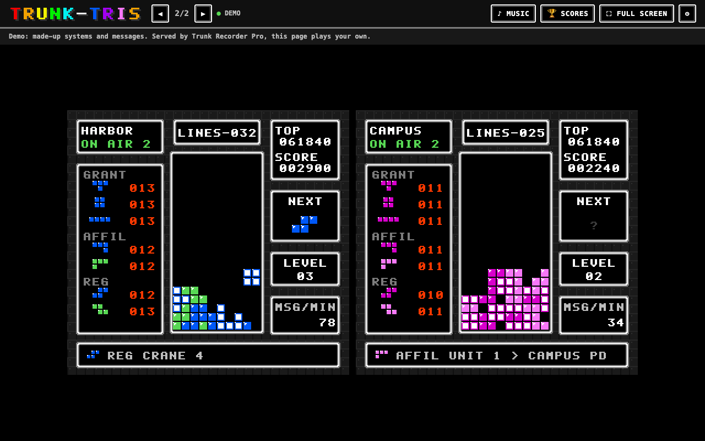
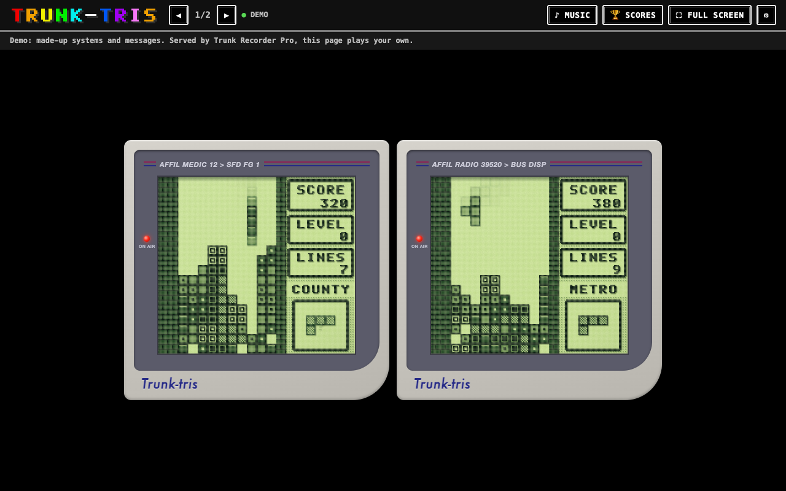

# Trunk-tris

A game of Tetris for each radio system your
[Trunk Recorder Pro](https://github.com/TrunkRecorder/trunk-recorder-pro) records, played by the
computer, with pieces made by the system's control channel. Every time a radio keys up, joins a
talkgroup or comes onto the system, the control channel says so, and some of those messages
become the next piece. It looks and sounds like NES Tetris, or like Tetris on the first Game Boy.
Put it on a spare screen and let it play.



## Getting it

In Trunk Recorder Pro, open **Interfaces**, find Trunk-tris in the store, and install it. Before
it's listed there, use **Install from GitHub…** with `TrunkRecorder/trunk-tris`.

It asks for listen access only: it can see and play what the recorder shows, and change nothing.

## Where the pieces come from

| Message on the control channel | What it means | Its pieces |
|---|---|---|
| **Grant** | a radio keyed up, and was given a channel | T, O, I |
| **Affiliation** | a radio joined a talkgroup | J, L |
| **Registration**, **deregistration** | a radio came onto the system, or left it | S, Z |

A busy system sends hundreds of these a minute, far more than a game can use. So a game takes one
only when it has room for the next piece: the first fitting message after the last piece appears
fills **NEXT**. Every other message is let go, and the game goes at its own pace however busy the
radio is.

In a fair game, every piece comes as often as any other. Grants outnumber registrations many
times over, so the pieces come out of a bag of the seven, as in modern Tetris: a message only
makes a piece that's still in the bag, and the bag fills again when it's empty. Over every seven
pieces, each one comes exactly once. A system that never sends a kind (SmartNet has no
registrations) would leave that kind's pieces in the bag for good, so after 8 seconds of waiting
any of the three kinds will do, and after 20, any message at all.

### As the radio sends them

With Settings → **Pieces** → **As the radio sends them**, there's no bag and nothing is evened
out. The first grant, affiliation or registration after a piece appears in the well makes the
next one, whatever its kind, and every message after it is let go until that piece appears in
turn. Nothing is kept for later. A system that's mostly grants plays mostly T, O and I; one that
never sends registrations never gets an S or Z; and a quiet system leaves the game waiting.

The statistics on the left of each game count the pieces under the message that makes them. The
line along the bottom shows the message that made the latest one: the grant's talkgroup, the
radio that affiliated and the talkgroup it joined, the radio that registered. A system with
nothing to say leaves **NEXT** empty, and its game waits.

## What you see

- **A game per system.** Every trunked system the recorder follows has one, running whether it's
  on the screen or not. Conventional systems have no control channel, so no game.
- **As many as fit.** On a wide screen, games sit side by side, and on a tall one, in rows. When
  there are more systems than fit, ◀ ▶ (or the arrow keys) shows the next ones, and they take
  turns by themselves every minute (Settings changes how often, or turns it off). A page doesn't
  turn while a game on it is showing its game over.
- **NES Tetris's screen.** LINES, TOP, SCORE, NEXT and LEVEL where the NES has them, and its
  colors, which change every level as they did. **Modern** colors (cyan I, yellow O and so on)
  and the Game Boy are in Settings, under **Look**. **MSG/MIN** is how many grants, affiliations and registrations the system
  sends a minute.
- **The computer plays.** It looks at every place a piece can go and picks one of the three best,
  usually the best. It slips now and then, so games end: about half an hour each at the relaxed
  pace with the **Good** player. **Beginner** loses sooner and **Expert** lasts hours.
- **Scoring** is NES Tetris's: 40, 100, 300 or 1200 points for one to four lines at once, times
  the level plus one, and a level every 10 lines. The pace stays gentle as the levels go up.
- **Message boxes** pop up over the well: **TETRIS!**, each new **LEVEL**, **NEW RECORD!** when a
  game passes the best score there's been, **GAME OVER**, and **NEW HIGH SCORE!** when it makes
  the table.
- **The high score table** is one for every system: the best ten games, with the system's short
  name and the date. It's shown between games, and any time under 🏆 **Scores**. It's kept in
  this browser, so each screen has its own.
- **On the air.** A system with calls on the air says so under its name, and with live audio on,
  the game whose call is playing is ringed in green.

## The Game Boy look

In Settings, **Look** → **Game Boy** (or press G) shows each game as Game Boy Tetris did, on a
Game Boy:



- **Its screen.** 160 × 144 pixels in four shades, laid out as Game Boy Tetris lays it out:
  brick walls on each side of a well 18 deep (the NES's is 20), SCORE, LEVEL and LINES in boxes
  on a dotted panel, and the next piece in its own box. With no colors, each of the seven pieces
  has its own pattern, as on the Game Boy. Full rows blink before they go, the well fills with a
  curtain at game over, and the box says PLEASE TRY AGAIN ♥. The high score table shows the
  best six (🏆 has all ten).
- **Its LCD**, recreated the way Game Boy emulators do it:
  - *Slow pixels.* The Game Boy's LCD took a few frames to change, so a falling piece leaves a
    fading trail. Each frame, every pixel moves part of the way to its new shade. The libretro
    Game Boy shader does this by blending in the frames before.
  - *A dot matrix.* Each pixel is a square of ink over a pale backing, with a lighter gap
    around it. Even a blank pixel is a little darker than the gaps, so the grid shows across
    the whole screen. The libretro shader calls this "base pixel transparency", and SameBoy's
    monochrome LCD filter dims each pixel's edges the same way.
  - *Shadows.* The ink sits above the backing and casts a soft shadow down and to the right. It
    shows through the pale pixels and in the gaps, like the libretro shader's offset, blurred
    shadow passes.
  - *Bloom.* A little of the picture again, smoothed, as SameBoy's LCD filter mixes in. This
    one is gentler.
  - *The backing.* A faint grain on the backing, lighter at the top left, and the bezel's
    shadow along the top and left edges, since the screen sits below it.
- **Its palettes**, the ones SameBoy uses: the first Game Boy's green, and, with **Game Boy
  Pocket**, the Pocket's gray.
- **The Game Boy around it**: the stripe across the top of the bezel shows the message that made
  the latest piece, and the red light is on while the system has calls on the air.

## Sound

- **♪ Music** (M): Korobeiniki, the Russian folk song that Tetris made famous, arranged here for
  the NES's pulse and triangle sounds and played in the browser. Nothing is downloaded.
- **Sound effects** (in Settings): lines, a Tetris, a new level, game over. Only the games on the
  screen make sounds.
- **🔊 Live** (L): the calls of the systems on the screen as they happen. The music goes quiet
  while the radio talks.

Browsers start sound only after a click, so these are off each time the page opens.

## Full screen

**⛶ Full screen** (F) fills the screen with games. The bar and the pointer go away after a few
seconds without a move, and come back with one.

## Settings

Under ⚙, kept in this browser:

- **Systems**: which ones have a game.
- **Games on the screen**: as many as fit (each at least twice the NES's size), or a number.
- **Show the next systems every**: 30 seconds to 5 minutes, or never.
- **Pace**: **Relaxed** (the default), **Normal** or **Lively**.
- **Player**: **Beginner**, **Good** or **Expert**.
- **Pieces**: **Fair** (the bag of seven, the default) or **As the radio sends them**.
- **Look**: **NES** (its colors change with the level), **NES, modern colors**, **Game Boy** or
  **Game Boy Pocket**. Changing between the NES and the Game Boy starts the games again, since
  their wells are different depths.
- **Sound effects**.

## Working on it

Plain ES modules, no build, nothing loaded from the internet. All art is drawn in code. The
font, the blocks and the screen are in `interface/js/font.js` and `screen.js`, and the music in
`music.js`.

```sh
node tools/serve.mjs --recorder 127.0.0.1:8080   # http://localhost:8099/, a recorder's systems
node tools/serve.mjs                              # then open /?demo: four made-up systems
node --test test/*.test.mjs                       # the rules, the player, the bag, the game
node tools/sim.mjs 40 15,20,30 18                 # how long games last at each skill (an 18-deep well)
node tools/shoot.mjs "http://localhost:8099/?demo&speed=8" shot.png   # a screenshot (Chrome)
```

`?speed=4` runs the games four times as fast. In the console,
`trunkTris.games.get("county").game.end()` ends a game, to see what comes after.

| File | |
|---|---|
| `tetris.js` | the rules: the well, NES Tetris's pieces and rotations, lines, scoring |
| `ai.js` | the computer player: Dellacherie's features, El-Tetris's weights, a temperature |
| `feed.js` | control messages → pieces: the kinds, the bag of seven, the texts |
| `game.js` | one system's game, on its own clock: moves, gravity, boxes, game over, the table |
| `screen.js` | drawing a game as an NES screen |
| `gameboy.js` | drawing a game as Game Boy Tetris, and the Game Boy's LCD |
| `app.js` | the page: systems, layout and paging, sound, live audio, settings, full screen |

Releases: set the version in `interface/interface.json`, add it to `CHANGELOG.md`, and push a tag
`v<version>`. The release workflow packages `interface/` and publishes it.

## License

MIT. Tetris is a trademark of The Tetris Company, and Game Boy of Nintendo. This is a fan-made
visualization, with its own code, art and arrangement of a folk song, and isn't affiliated with
The Tetris Company or Nintendo.
